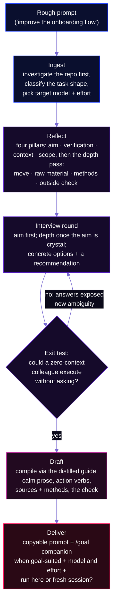
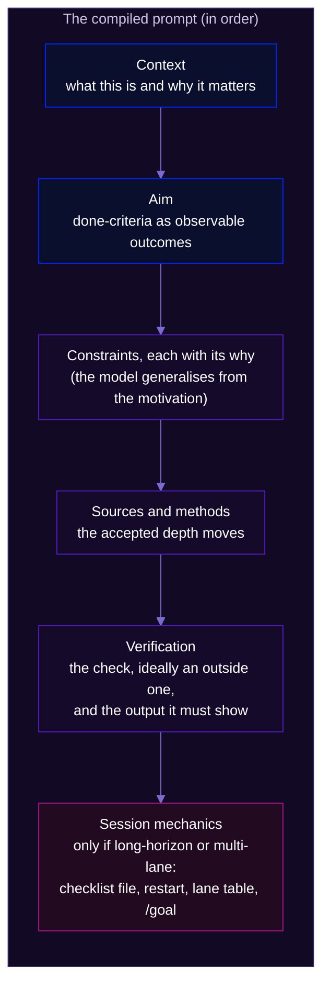

# promptify

**The interview-first prompt compiler for Claude 5 sessions.**


Claude 5 models run for hours, test their own work and fix their own mistakes, so the leverage sits in the prompt. promptify takes a rough prompt ("improve the onboarding flow") and interviews you until the aim is crystal. Then it compiles a prompt with an observable goal, verification the model can run without you, and the *why* behind every constraint. It now also runs a **depth pass**: the sources, methods and outside check a top professional would use, so the session goes deeper rather than just bigger. It targets Opus 5.5 by default and Fable 5.1 when Opus falls short. Happy building!

*Formerly `fable-promptify`. The old repo URL redirects here, and `/fable-promptify` still works as an alias.*

**Quick start:**

```bash
npx skills add yungbose/promptify
```

```
/promptify <your rough prompt>
```

<p align="center">
  
</p>

## Why this exists

For every serious prompt I was re-deriving the same rules from scattered sources: Anthropic's prompting docs, the per-model guides, the Claude Code team's loop and `/goal` write-ups. So I distilled them once into a reference file that the skill reads at draft time, and I re-distil it when a new model ships.

The Fable 5 launch video also named a trap I kept hitting: *"I might not actually know what I want."* Give a Claude 5 model a vague prompt and it builds *an* interpretation, and builds it so well that you never notice the aim was never yours. The video's fix is "ask Claude to interview me before writing the spec". This skill makes that automatic.

## How it works



### The four pillars

A prompt earns the model's autonomy when four things are crystal. The reflection phase scores the rough prompt against them, and the interview asks only about what's missing.

| Pillar | Crystal when... |
|---|---|
| **Aim** | "Done" is an observable outcome, not an activity: "users can export a CSV of X", not "work on exports" |
| **Verification** | The model can check its own work without you: tests, a rubric of checkable criteria, observable behaviour, and the output it must show |
| **Context** | Every constraint carries its motivation: "this is an experiment, real chance we delete it in a month", not "keep it simple" |
| **Scope & ambition** | Boundaries are explicit (what not to touch), and the ambition level is stated as named extras, not a blanket "go beyond the basics" |

### Deeper, not bigger: the depth pass

The pillars check that a prompt is *clear*. They don't check that it's *deep*. A rough prompt describes the work at the level of detail you already have, so a model that follows it literally starts from the same digested inputs and checks itself against the same assumptions.

The depth pass comes from a meta-prompt I saw an Anthropic engineer use:

> I want a deeper version of this task, not a bigger one. Before rewriting it: (1) say what a top professional in this field would do here that I'm not asking for; (2) name the rawest material they would start from instead of what has already been digested for me; (3) name the specific methods and tools they would use; (4) say what, other than you or me, would show the result is right. Then rewrite my prompt to ask for exactly that.

promptify runs those four questions itself, concretely and with names, on every task except quick fixes. It puts the answers to you as an interview question, so you can accept them, drop them, or point it at a better source it missed. The ones you accept go into the prompt as named sources to start from, named methods, and an outside check as the verification. Two rules keep it honest:

- **Deeper, not bigger.** A depth move changes the source, method or proof behind the aim you already have. Anything that adds a new deliverable becomes an ambition question instead.
- **The aim comes first.** While the aim is still vague, round 1 is spent on the aim, and the depth pass waits. Going deeper on the wrong aim is wasted effort.

On a research prompt ("which companies are building benchmarks in our field, so I can position against them"), the old skill asked good questions but named no raw sources, no methods and no outside check. With the depth pass, round 1 proposed:

- **Raw material:** benchmark papers, repos, dataset cards and leaderboard submitter lists.
- **Methods:** Semantic Scholar forward citations and Hugging Face download counts, to measure adoption rather than existence.
- **Outside check:** hold back the entrants you already know, and measure what share the research rediscovers.

A blind judge preferred the new version, and an aim-only blind test showed that aim clarification didn't regress.

### What the compiled prompt looks like



The task shape decides how much of this you get. A quick bug fix compiles to 3 to 8 lines (aim and verification, nothing else). A long-horizon autonomous run adds a checklist file, restart instructions and the unattended-run block. A multi-lane build adds a table saying which model and effort each lane runs on. The right amount of prompt is the minimum the task needs; importing every best practice into every prompt is one of the failure modes the skill guards against.

## Goal-suited tasks get a second artifact: the /goal companion

Claude Code's [`/goal`](https://code.claude.com/docs/en/goal) turns a session into a goal-based loop. After every turn, a small fast evaluator model reads your condition plus the transcript and decides whether the work is done; "not met" sends the model back to work, with the reason as steering. Two mechanics shape everything: the condition is capped at **4,000 characters**, and the evaluator **runs no tools**, so it can only judge what the session has put in the transcript.

So when a task has deterministic exit criteria (tests pass, the build exits 0, a score clears a threshold), promptify compiles a **second artifact** alongside the prompt: a compact completion contract for the evaluator. Every criterion pairs a measurable end state with the check that proves it ("`npm test` exits 0: run it and show the summary"). The contract also carries the constraints that matter and a turn cap inside the text. The context and the *why* stay in the prompt; the goal carries only what the evaluator needs to answer yes or no.

Delivery is keyed to task shape:

| Task shape | Pattern | Why |
|---|---|---|
| Quick verifiable task | **Goal-only**: one `/goal` line carries task + check + cap | Setting a goal immediately starts a turn; no separate prompt needed |
| Feature build / long-horizon | **Spec file + compact goal** (the default): compiled prompt saved as a handover file, goal says "implement the spec in `<file>` fully" + the contract | One paste; every turn including the first is goal-evaluated; the file survives context refreshes |
| Already mid-session | **Prompt-then-goal**: paste the prompt, set the goal once work is underway | Supported, but in a fresh session the spec-file pattern needs one paste and has no unevaluated first turn |

The one thing it never does is cram the compiled prompt into the goal argument. The 4,000-character cap forces lossy compression of exactly what makes a prompt work (context with its why), and the evaluator re-reads the condition every turn: it needs the contract, not the story.

Subjective outcomes (design taste, prose voice) are deliberately *not* goal-suited, because a small evaluator model can't judge them. Those get your own review after the run.

## Getting started

Install with the open skills CLI:

```bash
npx skills add yungbose/promptify
```

Or copy it into your agent's skills directory by hand (`~/.claude/skills/` for Claude Code):

```bash
git clone https://github.com/yungbose/promptify.git
cp -r promptify/promptify ~/.claude/skills/promptify
cp -r promptify/fable-promptify ~/.claude/skills/fable-promptify   # optional: keeps the old name working
```

Then, in any session:

```
/promptify make the expenses dashboard better
```

It will investigate your repo and ask what "better" means, offering concrete options. It keeps asking until the aim passes the exit test, then proposes the depth moves. It hands you a compiled prompt with the target model and effort, plus the choice: run it here, or paste it into a fresh session.

**A note on routing.** Multi-lane handovers follow a routing policy that maps work to models. The skill reads the author's (`~/.claude/skills/_shared/ROUTING.md`) when it exists. Without one, the lane table in `SKILL.md` Phase 4 is the default: swap in your own models and launchers.

## Built with its own discipline

Every change goes through a staging contract (via [upskill](https://github.com/yungbose/upskill)) and a RED/GREEN test before it reaches the skill. The tests stay in `promptify/tests/` as permanent regression checks.

| Test | Without the change | With it |
|---|---|---|
| `interview-first.md` | A polished prompt on an invented aim in the first response | An interview round with options and a recommendation; exit test applied; no padding rounds |
| `goal-companion.md` | No goal, or the whole prompt crammed into the goal argument | A transcript-verifiable contract under 4,000 characters, the right delivery pattern, the character count reported |
| `multi-lane-routing.md` | Routing in prose; lanes inherit the session model | A lane table with a model and effort on every row; no blanket serial rule |
| `depth-pass.md` | Clear questions, but no raw sources, methods or outside check | Named raw material, methods and a held-back recall check; preferred by a blind judge; aim clarification no worse |

## Design decisions

### 1. Interview until crystal, not a fixed round count
The exit condition is a quality gate, not a question budget: *could a colleague with zero context execute from the current understanding without asking a single question?* It takes one round if the rough prompt was nearly there, and several if each answer exposes new ambiguity. The same test prevents the opposite failure: interviewing past clarity is annoyance, not rigour, so the skill stops the moment the test passes.

### 2. The deliverable is the prompt, never the execution
The skill never drifts into doing the task mid-flow. Refining and executing are different jobs with different context needs. The refined prompt usually belongs in a *fresh* session, precisely because the current one has accumulated unrelated context. Execution is offered at the end as an explicit choice, not assumed.

### 3. Four pillars as the rubric, not a checklist of tips
The source documents contain dozens of techniques, and most are situational. The reflection phase deliberately scores against only four things (aim, verification, context, scope and ambition), because those decide whether the model's autonomy works for you or against you. Everything else (XML tags, examples, prompt ordering) is drafting mechanics, applied at compile time from the reference guide without bothering you.

### 4. Context, not constraints, enforced at interview time
"Keep it simple" copied verbatim into the output is a compile failure. When you give a bare constraint, the interview asks for the motivation behind it, and the compiled prompt carries the why ("this is an experiment; don't build anything painful to throw away"). Models generalise from motivations, so they catch things you didn't think to forbid. Bare rules don't generalise.

### 5. Calm prose, by rule
No CAPS, no "MUST", no "CRITICAL" in compiled prompts. Aggressive emphasis was a crutch for older models that under-triggered; current models over-trigger on it instead. The same goes for "double-check your work" lines on Opus, which cause over-verification: the skill gives the check itself, not an instruction to check.

### 6. Investigate before asking
A question the repo can answer is a wasted interview round and an erosion of trust. The ingest phase reads the project's CLAUDE.md, the relevant files and the recent commits first. The interview only asks what reflection flagged *and* the repo can't answer. "What test framework do you use?" is a Read, not a question.

### 7. The best practices live in one reference file
Everything is distilled into `references/prompting-guide.md`, including the per-model differences between Opus 5.5, Sonnet 5.5, Haiku 5.5 and Fable 5.1. The skill reads that file at draft time rather than working from memory. When Anthropic publishes new guidance, that one file is updated and the skill's behaviour updates with it.

### 8. Right-sized output over complete output
Every line of the compiled prompt must earn its place. A 10-line bug-fix prompt padded with long-horizon boilerplate is worse than the rough original. The task shape is classified at ingest, and the draft phase pulls only the guide sections that shape needs.

### 9. The goal is a contract for the evaluator, not a compressed prompt
Prompt and goal are different artifacts for different readers. The model reads the prompt, which carries context, motivation and instructions at whatever length the task needs. A small evaluator re-reads the goal every turn and runs no tools, so the goal carries only transcript-verifiable criteria, constraints and a turn cap, under 4,000 characters. This follows the loop taxonomy in the Claude Code team's ["Designing Loops for Claude Code Agents"](https://x.com/ClaudeDevs/status/2074208949205881033): you hand the goal-based loop *the stop condition*.

### 10. Improvement wiring from day one
The skill ships with the [upskill](https://github.com/yungbose/upskill) artifact set:

- `learnings.md`, read at the start of every run;
- `run-journal.md`;
- a domain-specific retrospective checklist;
- a `tests/` folder.

If you keep revising compiled prompts the same way, the retrospective captures it, and the correction applies on the next run.

### 11. Deeper, not bigger
The depth pass is the one place the skill adds ambition by itself, so it is fenced in. A depth move must change the source, method or proof behind an aim you already have. It is shown to you rather than silently added, and it waits until the aim is settled. An outside check is preferred over a self-check because the model reviewing its own work, or you approving it, are the two verifiers that share the prompt's blind spots.

## Sources

The reference guide distils these:

1. **[Anthropic prompting best practices](https://platform.claude.com/docs/en/build-with-claude/prompt-engineering/claude-prompting-best-practices)**: clarity and directness, context behind instructions, XML structure, calm prompting, long-horizon state, anti-test-gaming guidance.
2. **Anthropic's per-model prompting pages** (fetched 19 Oct 2026): [Opus 5.5](https://platform.claude.com/docs/en/build-with-claude/prompt-engineering/prompting-claude-opus-5-5), [Opus 5](https://platform.claude.com/docs/en/build-with-claude/prompt-engineering/prompting-claude-opus-5), [Fable 5.1](https://platform.claude.com/docs/en/build-with-claude/prompt-engineering/prompting-claude-fable-5-1), [Fable 5](https://platform.claude.com/docs/en/build-with-claude/prompt-engineering/prompting-claude-fable-5), [Haiku 5.5](https://platform.claude.com/docs/en/build-with-claude/prompt-engineering/prompting-claude-haiku-5-5) and [effort](https://platform.claude.com/docs/en/build-with-claude/effort). These are the source of the target-model defaults, the no-verify-again rule on Opus and the reasoning-extraction hazard.
3. **[Fable 5 launch video](https://x.com/ClaudeDevs/status/2064399512664526853)** (Thariq, [@trq212](https://x.com/trq212), Claude Code team): the mindset shift from supervising to directing; the interview-me pattern; context, not constraints.
4. **["Designing loops with Fable 5"](https://x.com/RLanceMartin/status/2064397389189071163)** (Lance Martin, [@RLanceMartin](https://x.com/RLanceMartin), Anthropic): design loops rather than steering; rubrics as environment feedback; the memory progression.
5. **["Fable is Mythos, and it is really good"](https://www.youtube.com/watch?v=7IewbRdaBWI)** (Theo, [@theo](https://x.com/theo), t3.gg): pre-empting strong priors with explicit convention deviations, and granting verification capability, not just criteria.
6. **["Designing Loops for Claude Code Agents"](https://x.com/ClaudeDevs/status/2074208949205881033)** ([@delba_oliveira](https://x.com/delba_oliveira), Claude Code team, July 2026): the four-loop taxonomy and the token-budget rules.
7. **[Official `/goal` docs](https://code.claude.com/docs/en/goal)**: the mechanics the goal companion is drafted against.
8. **The depth-pass meta-prompt** (quoted above): seen in use by an Anthropic engineer, October 2026. I haven't been able to trace the original post, so it is quoted as seen.

## Pairs with upskill

promptify front-loads clarity into a session; [upskill](https://github.com/yungbose/upskill) extracts learning out of it afterwards. Use both and a session is bracketed: a compiled aim going in, compiled corrections coming out.

## Further reading

| File | Purpose |
|---|---|
| `promptify/SKILL.md` | The full procedure (five phases, depth pass, exit test, lane table, common mistakes) |
| `promptify/references/prompting-guide.md` | The distilled guide (per-model deltas, four pillars, depth, effort, style rules, per-shape additions, loops and /goal, anti-patterns) |
| `promptify/references/retrospective-checklist.md` | Domain-specific retro checks |
| `promptify/tests/` | The RED/GREEN regression tests |
| `fable-promptify/SKILL.md` | The legacy alias, so `/fable-promptify` keeps working |
